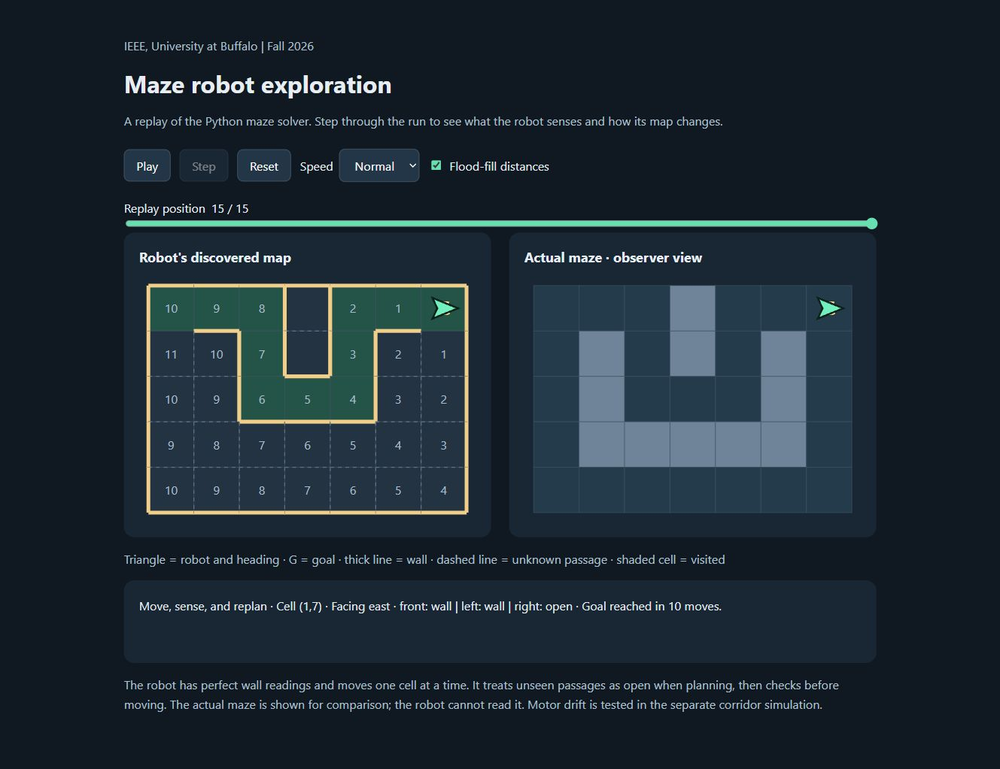

# Maze robot

IEEE, University at Buffalo | Fall 2026

[Open the replay](https://byronbradley.github.io/maze-robot/) · [Firmware](firmware/README.md) · [Wiring](hardware/wiring.md)

[](https://github.com/byronbradley/maze-robot/actions/workflows/tests.yml)



Flood-fill maze navigation with a Python simulator, browser replay, and Nano 33 BLE firmware. The firmware controls two motors through a DRV8833 and reads three ultrasonic wall sensors.

## Run

Python 3.12; no extra packages.

```sh
python maze_sim.py
python -m unittest discover -v
```

The demo compares a full-map route with exploration using front, left, and right wall readings, then runs a corridor-following experiment.

## Navigation

The robot starts with its pose, maze dimensions, boundary, and goal. Wall observations update both sides of each passage. Flood-fill treats unseen passages as open when planning, but movement requires a confirmed opening. Distances are recalculated after sensing.

The Python explorer uses exact cell positions and wall readings. Its exploration route can be longer than the shortest route through the completed map.

## Replay

Use the live link above or open `visual_sim.html`. Play, step, change speed, or drag the slider to compare the discovered map with the actual maze.

After changing the maze, explorer, or page template:

```sh
python export_visual.py
```

The exporter records the Python run and generates `index.html` for GitHub Pages and an identical `visual_sim.html` for offline viewing.

## Corridor following

`python wall_following.py` compares feedback on and off in a 30 cm corridor. A 10 cm robot starts 3 cm left of center, with its left motor running at 94% of the requested speed. Side-distance and heading feedback correct drift. A second run drops a sensor reading for one second to exercise stop and recovery.

This model runs independently of grid navigation. It uses wheel speeds in m/s, ideal perpendicular wall ranges, and instantaneous stops.

[Controller experiments](docs/controller-results.md) compare nine gain combinations and check the defaults with both drift directions and sensor dropout. Reproduce the tables with `python controller_experiment.py`.

## Firmware

The [Arduino sketch](firmware/README.md) includes an 8×8 map, interrupt-based echo capture, PWM motor control, and sensing/turning/driving states. Movement uses configurable cell and turn durations. See the firmware guide for calibration, serial commands, and build instructions.

[Architecture and tests](docs/architecture.md) covers the modules and automated checks. [Design decisions](docs/design-decisions.md) explains the planning and control choices.
