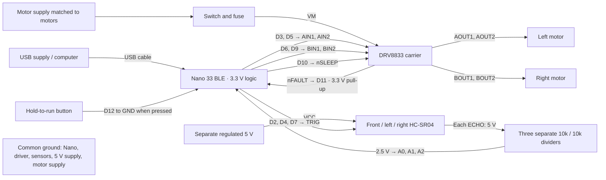

# Nano 33 BLE wiring

Design assumptions: original Nano 33 BLE (ABX00030), a DRV8833 carrier with accessible IN1/IN2, nSLEEP and nFAULT pins, two brushed DC gearmotors, and three HC-SR04 sensors accepting a 3.3 V trigger. Carrier pin locations vary; use signal names, not physical pin order. This is a wiring design, not a record of a completed assembly.

## Connections



| Nano pin | Connect to | Purpose |
|---|---|---|
| D3 / D5 | DRV8833 AIN1 / AIN2 | Left motor PWM/direction |
| D6 / D9 | DRV8833 BIN1 / BIN2 | Right motor PWM/direction |
| D10 | nSLEEP | Driver enable; 10k pulldown to GND |
| D11 | nFAULT | Open-drain fault; 10k pull-up to Nano 3V3 |
| D12 | Normally open button to GND | Hold to run; internal pull-up |
| D2 | Front TRIG | Trigger output |
| D4 | Left TRIG | Trigger output |
| D7 | Right TRIG | Trigger output |
| A0 | Front divided ECHO | Echo input |
| A1 | Left divided ECHO | Echo input |
| A2 | Right divided ECHO | Echo input |
| GND | Common ground | Shared signal reference |

### One echo divider per sensor

```text
HC-SR04 ECHO ----- 10k ohm -----+----- Nano echo input
                              |
                           10k ohm
                              |
                             GND
```

At a 5 V echo, the input receives about 2.5 V. Use 1% resistors. Do not connect the raw echo to the Nano: its inputs are not 5 V tolerant. All three sensors need their own divider. For modules that do not reliably accept 3.3 V TRIG, use a proper 3.3-to-5 V logic buffer on each trigger or select a compatible sensor; do not put 5 V on a Nano output.

## Power and driver details

- Power the Nano through its USB connector for initial bring-up. Supply sensor VCC from a separate regulated 5 V rail. Do not assume the Nano's VUSB header supplies 5 V; that connection is disabled by default on the original board. Do not feed the motor rail into 3V3 or VUSB.
- The DRV8833 IC's operating motor-supply range is 2.7–10.8 V. Select a supply within the carrier's limits and the motors' ratings, including battery fully charged voltage and motor stall current. A carrier's continuous current rating depends on its package, thermal design and current-limit configuration.
- Connect the motor supply negative, regulator ground, sensor ground, Nano ground and driver ground. Route motor return current directly to the driver/supply, rather than through the Nano or sensor ground wires.
- Use a carrier with the TI-required local ceramic decoupling and appropriate bulk capacitance at VM. Fit bulk capacitance according to the carrier documentation and supply/wiring characteristics. Do not build a bare-IC circuit from this signal diagram alone.
- Verify any carrier pull-ups before connection. nFAULT must not be pulled up above 3.3 V. nSLEEP must not have a carrier pull-up to a higher motor rail; remove/configure it per the carrier documentation before connecting D10. The external 10k nSLEEP pulldown keeps a compatible carrier disabled during reset.
- AIN1/AIN2 and BIN1/BIN2 select direction. Both LOW is coast; both HIGH is brake. This firmware uses coast on zero command and disables the driver on a fault; stopping is not instantaneous.

## Bring-up order

1. With motor power disconnected, check grounds, pin labels, and divider resistance. Verify the 5 V sensor rail and divided echo voltage before connecting the echo inputs.
2. Upload the sketch and send `p` in Serial Monitor at 115200 baud. Compare front/left/right ranges with a ruler. A missing echo is invalid, not an open passage.
3. Check driver enable/fault wiring and motor direction with wheels lifted using a separately reviewed bench test. Confirm that positive left/right commands physically drive forward; configure inversion flags as needed.
4. Measure the PWM, one-cell drive duration and quarter-turn duration for the actual chassis. Set the firmware constants and enable its calibration gate only after checking motion and stopping clearance. The hold-to-run button and serial `s` request a stop; use the motor-supply switch for physical power removal.
5. Set map dimensions, goal, and starting pose to match the physical maze. Reset only after returning the chassis to its starting cell and heading.

## Sources

- [Arduino Nano 33 BLE pinout](https://docs.arduino.cc/resources/pinouts/ABX00030-full-pinout.pdf)
- [Arduino Nano board voltage guidance](https://docs.arduino.cc/learn/hardware/nano-pcb-guide/)
- [Arduino VUSB jumper guidance](https://support.arduino.cc/hc/en-us/articles/360014779679-Supply-USB-power-via-the-VUSB-VBUS-or-5V-pin-on-Nano-boards)
- [TI DRV8833 datasheet](https://www.ti.com/lit/ds/symlink/drv8833.pdf)
- [Adafruit HC-SR04 power, trigger and echo guidance](https://learn.adafruit.com/ultrasonic-sonar-distance-sensors/pinouts)
