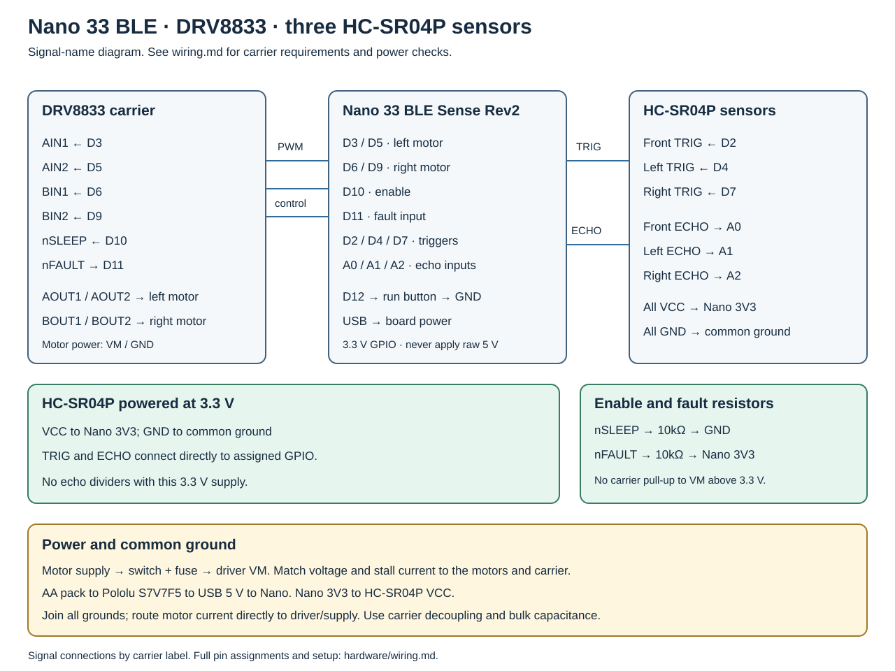

# Wiring

Nano 33 BLE Sense Rev2 (ABX00070), Adafruit DRV8833 #3297, DIYables 2WD chassis and three HC-SR04P sensors. See [parts](parts.md).

## Pin assignments

| Nano pin | Connection |
|---|---|
| D3 / D5 | DRV8833 AIN1 / AIN2: left motor |
| D6 / D9 | DRV8833 BIN1 / BIN2: right motor |
| D10 | nSLEEP; 10k pulldown to GND |
| D11 | nFAULT; 10k pull-up to Nano 3V3 |
| D12 | Normally open run button to GND; internal pull-up |
| D2 / D4 / D7 | Front / left / right TRIG |
| A0 / A1 / A2 | Front / left / right ECHO directly |
| GND | Driver, sensors, and both supply grounds |

AOUT1/AOUT2 connect to the left motor; BOUT1/BOUT2 connect to the right motor.

## Sensor voltages

Power the selected HC-SR04P modules from Nano 3V3. Connect ECHO directly to A0/A1/A2 and TRIG to D2/D4/D7. Verify sensor supply and echo voltage before connecting GPIO. Do not fit echo dividers with this 3.3 V sensor supply. A 5 V-only HC-SR04 replacement needs separate voltage protection and compatible trigger inputs.

## Power

- Four NiMH AA cells feed driver VM and Pololu S7V7F5 VIN in parallel. Connect the regulated 5 V output and GND to the USB adapter, then power the Nano through Micro-USB. Sensors use Nano 3V3. Keep motor current off the Nano power rails.
- DRV8833 VM operates at 2.7–10.8 V. Match the supply to the carrier and motor ratings, including full battery voltage and motor stall current.
- Join grounds, but route motor current directly between the driver and supply. Use the carrier's specified ceramic decoupling and bulk capacitance at VM.
- Check carrier pull-ups: nFAULT and nSLEEP connections to the Nano must stay within 3.3 V logic levels. Configure or remove higher-voltage carrier pull-ups before connecting them. The nSLEEP pulldown keeps the driver disabled during reset.
- Both bridge inputs LOW select coast; both HIGH select brake. The sketch coasts at zero command and disables the driver on faults.

## Setup

1. Disconnect motor power. Check grounds, regulated USB power, the 3.3 V sensor rail and echo voltages.
2. Upload and send `p` at 115200 baud. Check each range against a ruler.
3. Lift the wheels and check motor direction. Adjust inversion flags so positive commands drive forward.
4. Measure one-cell and quarter-turn durations, then configure PWM, motion timing, and clearance thresholds. Enable `MOTION_CALIBRATED` after calibration.
5. Set the map and starting pose. Use the supply switch to remove motor power; return the chassis to its starting pose before resetting navigation.

## References

- [Nano 33 BLE pinout](https://docs.arduino.cc/resources/pinouts/ABX00070-full-pinout.pdf)
- [Nano voltage guidance](https://docs.arduino.cc/learn/hardware/nano-pcb-guide/)
- [VUSB jumper](https://support.arduino.cc/hc/en-us/articles/360014779679-Supply-USB-power-via-the-VUSB-VBUS-or-5V-pin-on-Nano-boards)
- [DRV8833 datasheet](https://www.ti.com/lit/ds/symlink/drv8833.pdf)
- [HC-SR04 signals](https://learn.adafruit.com/ultrasonic-sonar-distance-sensors/pinouts)
